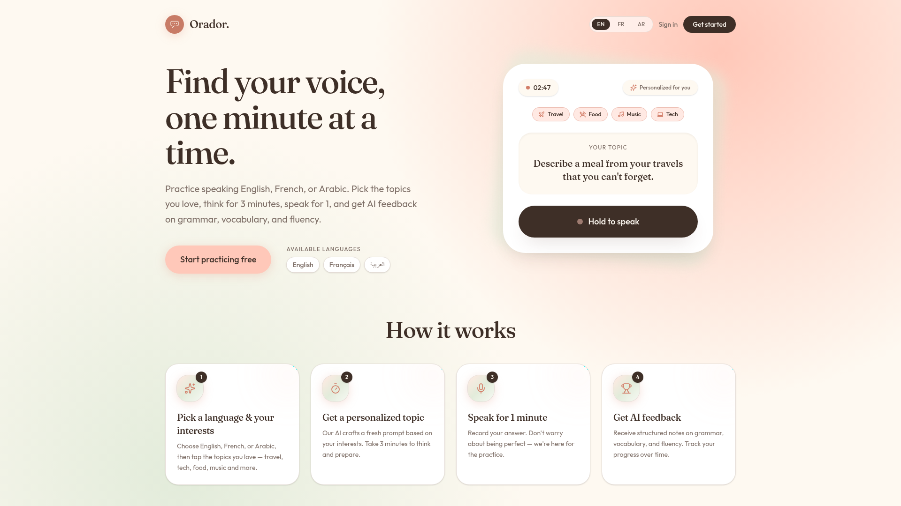
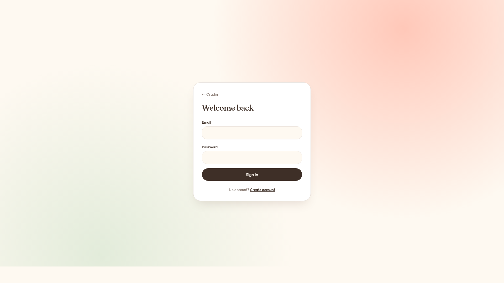
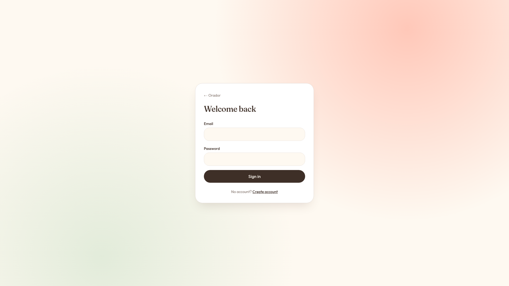

# Orador

> AI-powered speaking practice for **English, French, and Arabic**. Pick a topic, think for 3 minutes, speak for 1, and get instant AI feedback on grammar, vocabulary, fluency, and pronunciation.

🌐 **Live:** [orador.lovable.app](https://orador.lovable.app)



---

## Table of contents

1. [What it does](#what-it-does)
2. [Screenshots](#screenshots)
3. [Tech stack](#tech-stack)
4. [Architecture](#architecture)
5. [Frontend](#frontend)
6. [UI components](#ui-components)
7. [Backend (server functions)](#backend-server-functions)
8. [Library helpers](#library-helpers)
9. [Database](#database)
10. [Authentication & security](#authentication--security)
11. [Observability & quotas](#observability--quotas)
12. [Payments](#payments)
13. [AI pipeline](#ai-pipeline)
14. [Storage](#storage)
15. [Internationalisation (i18n)](#internationalisation-i18n)
16. [Design system](#design-system)
17. [SEO](#seo)
18. [Testing](#testing)
19. [Project structure](#project-structure)
20. [Environment variables](#environment-variables)
21. [Local development](#local-development)
22. [Deployment](#deployment)

---

## What it does

Orador turns the well-known **4-3-2 deliberate-practice speaking method** into a daily ritual:

1. **Pick a language and your interests** — English, French, or Arabic, plus topics you actually care about (travel, tech, food, music…).
2. **Get a personalised topic** — the AI generates a fresh prompt at your CEFR level (A1 → C2).
3. **Think for 3 minutes, speak for 1** — record straight from the browser.
4. **Receive structured AI feedback** — grammar, vocabulary, fluency, pronunciation, and an overall summary, with progress tracked over time.

A free tier lets users try a handful of sessions; **lifetime access** is unlocked through PayPal with locale-aware pricing.

---

## Screenshots

| Landing | Sign in | Upgrade |
| --- | --- | --- |
|  |  |  |

---

## Tech stack

| Layer | Choice |
| --- | --- |
| Framework | **TanStack Start v1** (React 19 + Vite 7, file-based routing, server functions) |
| Language | TypeScript (strict) |
| Styling | **Tailwind CSS v4** with `oklch` design tokens in `src/styles.css` |
| UI primitives | **shadcn/ui** + Radix UI |
| Icons | lucide-react |
| Forms | react-hook-form + zod |
| Data fetching | @tanstack/react-query |
| Backend runtime | Cloudflare Workers (via `@cloudflare/vite-plugin`, `wrangler.jsonc`) |
| Database & Auth | **Supabase** — Postgres + RLS + Auth + Storage |
| AI gateway | **Managed AI Gateway** — Google Gemini 2.5 Flash for text and audio understanding |
| Speech-to-text | ElevenLabs Scribe (audio path) + Gemini fallback |
| Payments | **PayPal** (REST API, server-verified webhook) |
| Analytics-friendly | SSR + sitemap.xml + JSON-LD |

---

## Architecture

```
┌──────────────────────────────┐        ┌─────────────────────────────────┐
│  React 19 / TanStack Router  │  RPC   │  TanStack server functions      │
│  (browser, SSR via Vite)     │ ─────▶ │  createServerFn(...) on Workers │
└──────────────────────────────┘        └────────────┬────────────────────┘
                                                     │
                          ┌──────────────────────────┼──────────────────────────┐
                          ▼                          ▼                          ▼
                  ┌───────────────┐         ┌───────────────┐         ┌──────────────────┐
                  │ Supabase      │         │ AI Gateway    │         │ PayPal REST API  │
                  │ Postgres+RLS  │         │ Gemini 2.5    │         │ (orders + caps)  │
                  │ Auth, Storage │         │ ElevenLabs    │         │ + webhook verify │
                  └───────────────┘         └───────────────┘         └──────────────────┘
```

- **All app-internal server logic** lives in `src/server/*.functions.ts` using `createServerFn` — no Supabase Edge Functions are used for app logic.
- **Webhooks** (PayPal) are exposed under `src/routes/api/public/*` so the path bypasses auth on published deploys; the handler verifies the signature itself.
- The browser **never** sees the service role key or any third-party secret — only the publishable Supabase key.

---

## Frontend

File-based routing under `src/routes/`:

| Route | Purpose |
| --- | --- |
| `/` | Landing page (hero, "How it works", language pills, JSON-LD) |
| `/signup`, `/login` | Email/password authentication |
| `/onboarding` | Pick target language, level, weekly goal, interests |
| `/practice` | Configure & start a 4-3-2 speaking session |
| `/session/$id` | Live timer → recording → submission → feedback |
| `/dashboard` | Personal stats, recent sessions, streaks |
| `/history` | Full session history with feedback drill-down |
| `/rankings` | Per-language leaderboard |
| `/account` | Profile, language, theme, sign-out |
| `/upgrade` | Locale-aware lifetime pricing + PayPal checkout |
| `/admin` | Admin dashboard (role-gated) |
| `/sitemap.xml` | Generated sitemap (server route) |
| `/api/public/paypal-webhook` | PayPal webhook receiver |

The **root layout** (`src/routes/__root.tsx`) wires:

- `AuthProvider` — Supabase session subscription, cache invalidation on auth change.
- `I18nProvider` — language + RTL handling.
- `Toaster` (sonner) — global notifications.
- `<HeadContent />` — per-route SEO meta and JSON-LD.

---

## UI components

App-specific components live in `src/components/`:

| Component | Purpose |
| --- | --- |
| `app-header.tsx` | Top navigation bar with logo, language switcher, account menu and admin link |
| `logo.tsx` | Brand wordmark + icon, reused in header, auth pages and favicon export |

The full **shadcn/ui** primitive set is in `src/components/ui/` — each restyled to the Orador palette via semantic tokens (never hard-coded hex):

| Category | Components |
| --- | --- |
| Layout | `card`, `separator`, `aspect-ratio`, `resizable`, `scroll-area`, `sheet`, `sidebar`, `skeleton` |
| Forms | `form`, `input`, `textarea`, `label`, `checkbox`, `radio-group`, `switch`, `select`, `slider`, `input-otp`, `toggle`, `toggle-group` |
| Buttons & badges | `button`, `badge`, `avatar` |
| Overlays | `dialog`, `alert-dialog`, `drawer`, `popover`, `hover-card`, `tooltip`, `sonner` (toasts) |
| Navigation | `breadcrumb`, `navigation-menu`, `menubar`, `pagination`, `tabs`, `dropdown-menu`, `context-menu`, `command` |
| Data display | `table`, `chart`, `progress`, `accordion`, `collapsible`, `calendar`, `alert`, `carousel` |

Hooks in `src/hooks/`:

- `use-mobile.tsx` — media-query helper used by responsive layouts and the sidebar primitive.

---

## Backend (server functions)

All endpoints live in `src/server/`. Each file is either a `*.functions.ts` (RPC handlers callable from React) or a `*.server.ts` (server-only helpers, never bundled to the browser).

| File | What it does |
| --- | --- |
| `account.functions.ts` | Read/update profile, change UI language, delete account |
| `admin.functions.ts` | Admin-only listing, role management, audit log writes (gated by sole-admin email + DB role check) |
| `analyze.functions.ts` | Download recording → Gemini transcription → Gemini structured feedback → persist `feedback`; writes score via `supabaseAdmin` so RLS blocks user tampering |
| `dashboard.functions.ts` | Aggregate sessions, scores and streaks for the dashboard |
| `history.functions.ts` | Auth-gated session history list (replaces a former direct client query) |
| `onboarding.functions.ts` | Save user preferences (language, level, weekly goal, interests) |
| `rankings.functions.ts` | Per-language leaderboard from aggregated session scores |
| `session.functions.ts` | Create a session, store the audio path, mark status |
| `topic.functions.ts` | Generate a CEFR-level topic via Gemini, cached in `topic_cache` to cut cost & latency |
| `paypal.functions.ts` | Create order, capture order, fetch user status, locale pricing |
| `paypal-config.functions.ts` | Expose only the safe PayPal client config (publishable client-id) to the browser |
| `paypal.server.ts` | Server-only PayPal helpers: country lookup, currency mapping, REST calls, masked error logging |
| `quota.server.ts` | `assertWithinFreeQuota` — server-side freemium cap to stop AI-credit drain via direct RPC |
| `observability.server.ts` | Structured server logging + error capture used across server fns |
| `auth-client-middleware.ts` | Attaches the Supabase bearer token to every server-fn RPC from the browser |

**Pattern used everywhere**:

```ts
export const generateTopic = createServerFn({ method: "POST" })
  .middleware([attachSupabaseAuth, requireSupabaseAuth])
  .inputValidator((data) => InputSchema.parse(data))   // Zod validation
  .handler(async ({ data, context }) => { /* ... */ });
```

Inputs are validated with **Zod** with min/max bounds and regex constraints to reduce attack surface.

---

## Library helpers

Shared client + server utilities in `src/lib/`:

| File | Purpose |
| --- | --- |
| `auth-context.tsx` | React context that subscribes to `supabase.auth.onAuthStateChange`, exposes `user`/`session`, and triggers router + query-cache invalidation on sign-in/out |
| `i18n.tsx` | EN/FR/AR dictionary + `<html lang>` / `<html dir>` (RTL) wiring |
| `interests.ts` | Curated, localised interests list used by onboarding & topic generation |
| `topic-cache.ts` | Deterministic interests hash + cache constants used by `generateTopic` |
| `observability.ts` | Client-side Sentry + PostHog wiring, `identifyUser`, funnel-event helpers |
| `utils.ts` | `cn()` (clsx + tailwind-merge) and other tiny helpers |

---

## Database

10 tables in the `public` schema, all with **Row Level Security enabled**:

| Table | Purpose |
| --- | --- |
| `profiles` | User-facing profile (display name, native lang, UI lang, theme) |
| `user_preferences` | Target language, CEFR level, weekly goal, interests |
| `user_roles` | App-role assignment (`user`, `admin`) — separate table to prevent privilege escalation |
| `levels` | CEFR levels A1–C2, localised names |
| `topics` | Pool of speaking prompts per language/level (admin-curated + AI-generated) |
| `sessions` | One speaking session: language, level, topic, audio path, transcript, score, status |
| `feedback` | Structured AI output: grammar, vocabulary, fluency notes, pronunciation notes, overall summary, raw JSON |
| `subscriptions` | Lifetime access records, currency-aware (`amount_minor` + `currency`), tied to PayPal order/capture IDs |
| `payment_requests` | Manual payment proofs (legacy MAD bank-transfer flow), admin-reviewable |
| `admin_audit_log` | Append-only log of admin actions (who did what, when, on whom) |
| `topic_cache` | Server-only cache of generated speaking prompts, keyed by `(lang, level, interests_hash)` |
| `rankings` (view) | Aggregated per-language leaderboard |

### Database functions

Security-definer helpers in Postgres:

- `has_role(_user_id uuid, _role app_role) → boolean` — used inside RLS policies, prevents recursive checks.
- `has_active_subscription(_user_id uuid) → boolean`
- `handle_new_user()` (trigger on `auth.users`) — creates profile + default `user` role, plus the sole admin if the email matches the configured owner.
- `enforce_sole_admin_email()` — trigger on `user_roles` that **rejects** any attempt to grant `admin` to anyone other than the configured owner email.
- `touch_updated_at()` — generic `updated_at` trigger.

---

## Authentication & security

- **Supabase Auth** with email + password (via the standard browser client).
- Sessions are persisted in `localStorage` and re-validated on every server-fn call by `requireSupabaseAuth` middleware.
- The browser-side `attachSupabaseAuth` middleware reads `supabase.auth.getSession()` and attaches `Authorization: Bearer <token>` to every RPC.
- **RLS is on for every table** with 21 policies. Examples:
  - `sessions_self_all` — users can only read/write their own sessions (`user_id = auth.uid()`).
  - `feedback_self_select / feedback_self_insert` — users can only see/insert their own feedback.
  - `topics_public_read` + `topics_admin_write` — topics are world-readable but only admins can edit.
  - `user_roles_admin_all` — only admins may modify roles; combined with the `enforce_sole_admin_email` trigger this makes admin promotion impossible from the app.
  - `subs_admin_all` + `pr_admin_update` — only admins can modify subscriptions / approve manual payment requests.
- **Roles live in their own `user_roles` table**, never on `profiles` — eliminates a whole class of privilege-escalation bugs.
- All server functions validate input with **Zod** (length limits, regex, enums).
- The PayPal webhook route verifies PayPal's `transmission_*` headers against the configured webhook ID before touching the database.
- The service role key is **only** imported by `src/integrations/supabase/client.server.ts` from server code — never bundled into the browser.
- 404 and error boundaries are wired at the router level (`DefaultErrorComponent` + `NotFoundComponent`).
- **HTTP security headers** are set globally in `src/start.ts`: `X-Frame-Options: DENY`, `X-Content-Type-Options: nosniff`, `Referrer-Policy: strict-origin-when-cross-origin`, `Permissions-Policy: microphone=(self)`, `Strict-Transport-Security`.
- Leaked-password protection (HIBP) is enabled in Supabase Auth.

---

## Observability & quotas

- **Client telemetry** (`src/lib/observability.ts`) — Sentry for error capture, PostHog for funnel events (`signup_completed`, `practice_topic_generated`, `session_analyzed`, …) with `identifyUser` on sign-in.
- **Server telemetry** (`src/server/observability.server.ts`) — structured logs and `captureServerException` used by every server fn that hits an external API; AI gateway and PayPal errors are logged in detail server-side but returned to the browser as generic messages.
- **Freemium quota** (`src/server/quota.server.ts`) — `assertWithinFreeQuota` runs *before* any AI gateway call in `generateTopic` and `analyzeSession`, so users cannot bypass the paywall by hitting RPCs directly.
- **Topic cache** (`src/lib/topic-cache.ts` + `topic_cache` table) — deterministic `(lang, level, interests_hash)` bucket; the server pulls from cache when there are enough prompts and excludes any prompt the user has already seen in the last 30 days.

## Payments

- **Provider:** PayPal (REST API, `@paypal/react-paypal-js` on the client).
- Lifetime, one-time purchase — no recurring billing.
- **Locale-aware pricing**: server detects country via `cf-connecting-ip` / `x-forwarded-for`, maps to a supported currency, and computes a localised price.
- **Server-verified flow**:
  1. `getLocalPrice` — server returns price + currency.
  2. `paypalCreateOrder` — server creates the PayPal order with the right amount/currency.
  3. Browser opens the PayPal popup.
  4. `paypalCaptureOrder` — server captures and persists the `subscriptions` row (with `paypal_order_id`, `paypal_capture_id`).
  5. **Webhook** (`/api/public/paypal-webhook`) — independent confirmation from PayPal, signature-verified, idempotent.

---

## AI pipeline

All AI calls go through the managed AI gateway, using `google/gemini-2.5-flash`.

1. **Topic generation** (`generateTopic`)
   - Inputs: target language, CEFR level, list of interests.
   - Output: a single, level-appropriate speaking prompt.

2. **Speech-to-text + feedback** (`analyzeSession`)
   - Downloads the user's recording from the `recordings` storage bucket (RLS-scoped).
   - Sends the audio to the gateway as base64 to Gemini (multimodal) for transcription.
   - Sends the transcript + topic + level back to Gemini with a structured-output schema asking for grammar, vocabulary, fluency, pronunciation notes, and an overall summary.
   - Persists the structured result into the `feedback` table.

API keys live in server env only.

---

## Storage

- **Bucket:** `recordings` (private).
- Audio uploads happen from the browser using the user's session, so RLS scopes the file path to the user.
- The `analyze` server function reads the file using the same authenticated client — no service-role read.

---

## Internationalisation (i18n)

- **Languages:** English, French, Arabic.
- A single in-memory dictionary in `src/lib/i18n.tsx` exposes `t.*` for nav, landing, practice, common, and auth namespaces.
- `<html lang>` and `<html dir>` are set automatically — Arabic flips the layout to RTL.
- The user's choice is persisted in `localStorage` (`ui_lang`) and on the `profiles.ui_lang` column once signed in.

---

## Design system

Defined entirely in `src/styles.css` using **`oklch` semantic tokens** so light/dark mode works without touching components:

| Token | Role |
| --- | --- |
| `--sunlight` | Warm off-white background |
| `--peach` | Accent (buttons, CTAs) |
| `--terracotta` | Highlights, focus rings |
| `--sage` | Secondary surfaces |
| `--ink` / `--ink-light` | Foreground text |
| `--shadow-soft` / `--shadow-elevated` | Branded peach-tinted shadows |

Typography:

- **Display:** Fraunces (variable serif) for headlines.
- **Sans:** Outfit for UI/body text.

Components never hard-code hex values — they use `bg-background`, `text-foreground`, `bg-accent`, `text-terracotta`, etc. The shadcn/ui set is fully restyled to the Orador palette.

---

## SEO

- **SSR** via TanStack Start ensures crawlers see fully rendered HTML.
- **Per-route `head()`** with unique `<title>`, `meta description`, and Open Graph tags.
- **JSON-LD** `SoftwareApplication` schema on the home page.
- **`/sitemap.xml`** generated at request time, listing the public routes.
- **`/robots.txt`** allows everything and points at the sitemap.
- **`/llms.txt`** — machine-readable summary for LLM-powered crawlers.
- **`/site.webmanifest`** + 192/512 icons → installable PWA shell.
- `theme-color`, `viewport-fit=cover`, and a Google Search Console verification meta tag are wired in `__root.tsx`.

---

## Testing

**Vitest** with `happy-dom` is configured via `vitest.config.ts`. Suites cover the pure-logic seams of the backend so they can run without a DB or HTTP server:

| File | What it covers |
| --- | --- |
| `src/lib/topic-cache.test.ts` | Deterministic interests hashing + cache bucket invariants |
| `src/server/paypal.server.test.ts` | Country → currency mapping, locale price math |
| `src/server/observability.server.test.ts` | Structured logger output + error capture envelope |

Run with `bunx vitest run`.

---

## Project structure

```
src/
├── routes/                       # File-based routes (TanStack Router)
│   ├── __root.tsx                # Root layout, providers, head meta, SEO
│   ├── index.tsx                 # Landing page
│   ├── login.tsx, signup.tsx
│   ├── onboarding.tsx
│   ├── practice.tsx
│   ├── session.$id.tsx
│   ├── dashboard.tsx, history.tsx, rankings.tsx
│   ├── account.tsx, upgrade.tsx, admin.tsx
│   ├── sitemap[.]xml.ts          # Server route → XML sitemap
│   └── api/public/
│       └── paypal-webhook.ts     # Signature-verified webhook
├── server/                       # createServerFn handlers (Workers runtime)
│   ├── account.functions.ts
│   ├── admin.functions.ts
│   ├── analyze.functions.ts
│   ├── dashboard.functions.ts
│   ├── history.functions.ts
│   ├── onboarding.functions.ts
│   ├── paypal.functions.ts
│   ├── paypal-config.functions.ts
│   ├── paypal.server.ts          # Server-only PayPal helpers
│   ├── rankings.functions.ts
│   ├── session.functions.ts
│   ├── topic.functions.ts
│   ├── quota.server.ts           # Free-tier enforcement
│   ├── observability.server.ts   # Structured server logging
│   ├── auth-client-middleware.ts # Attaches bearer token client-side
│   ├── observability.server.test.ts
│   └── paypal.server.test.ts
├── components/
│   ├── app-header.tsx            # Top navigation
│   ├── logo.tsx                  # Brand mark
│   └── ui/                       # shadcn/ui primitives (46 components)
├── hooks/
│   └── use-mobile.tsx
├── lib/
│   ├── auth-context.tsx          # Supabase session provider
│   ├── i18n.tsx                  # EN/FR/AR + RTL
│   ├── interests.ts              # Curated interests list
│   ├── topic-cache.ts            # Deterministic cache helpers
│   ├── topic-cache.test.ts
│   ├── observability.ts          # Sentry + PostHog client wiring
│   └── utils.ts                  # cn() helper
├── integrations/supabase/        # ⚠ auto-generated, do not edit
│   ├── client.ts                 # Browser client (publishable key)
│   ├── client.server.ts          # Admin client (service role, server only)
│   ├── auth-middleware.ts        # requireSupabaseAuth
│   ├── auth-attacher.ts          # Bearer-token client middleware
│   └── types.ts
├── router.tsx                    # createRouter + DefaultErrorComponent
├── start.ts                      # Global server middleware (security headers)
├── routeTree.gen.ts              # ⚠ auto-generated by router plugin
└── styles.css                    # Tailwind v4 + design tokens
public/
├── robots.txt
├── llms.txt
├── site.webmanifest
└── icon-192.png / icon-512.png
supabase/
└── config.toml                   # Project ref only — no edge functions
docs/screenshots/                 # README screenshots
vitest.config.ts                  # Vitest + happy-dom
wrangler.jsonc                    # Cloudflare Workers config
components.json                   # shadcn/ui config
```


---

## Environment variables

Managed automatically (do not edit `.env` manually):

**Browser (build-time, `import.meta.env.VITE_*`):**

- `VITE_SUPABASE_URL`
- `VITE_SUPABASE_PUBLISHABLE_KEY`
- `VITE_SUPABASE_PROJECT_ID`

**Server-only (`process.env.*`, never bundled):**

- `SUPABASE_URL`
- `SUPABASE_PUBLISHABLE_KEY`
- `SUPABASE_SERVICE_ROLE_KEY`
- `LOVABLE_API_KEY` — AI gateway
- `ELEVENLABS_API_KEY` — speech-to-text
- `PAYPAL_CLIENT_ID`, `PAYPAL_SECRET`, `PAYPAL_ENV`, `PAYPAL_WEBHOOK_ID`
- `GOOGLE_SEARCH_CONSOLE_API_KEY` (managed by connector)

---

## Local development

```bash
bun install
bun run dev          # Vite dev server with SSR
bun run build        # Production build (Cloudflare Workers target)
bun run preview      # Preview the production bundle
bun run lint         # ESLint
bun run format       # Prettier
```

> Database, auth, storage, AI, and secrets are all provisioned by the managed backend — there's nothing to spin up locally.

---

## Deployment

- **Hosting:** Cloudflare Workers via `@cloudflare/vite-plugin` (`wrangler.jsonc`).
- **Live URL:** `https://orador.lovable.app` (or a custom domain).

